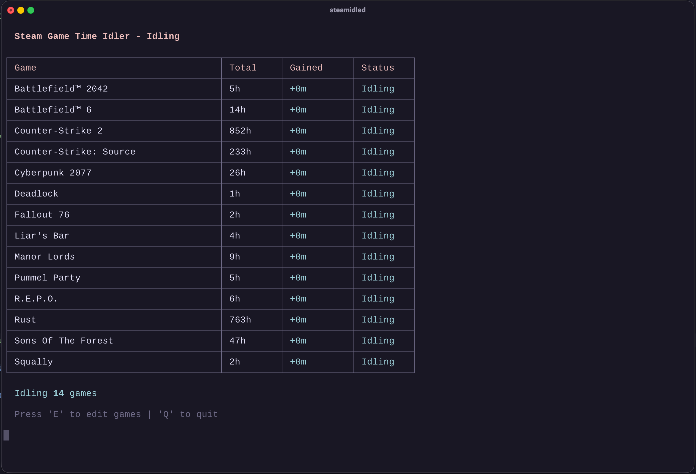
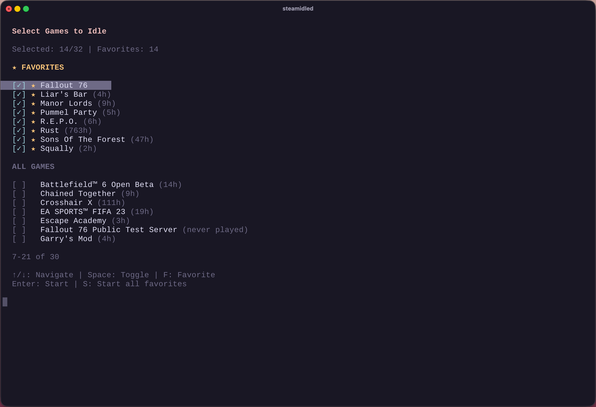

# steamidled

A command-line Steam game idler. It logs in to your Steam account and reports up to 32 games as being played, so they accumulate playtime and trading card drops without the games running. It can be used interactively or as a headless background service.

This repository is a fork of [louisraetz/steamidled](https://github.com/louisraetz/steamidled) (v1.2.0). It replaces the upstream Telegram notifications with Discord notifications and removes the Docker setup.

<p align="center">
  
  
</p>

## Features

- Log in with a QR code from the Steam mobile app, or with username, password and Steam Guard
- Idle up to 32 games at once (the Steam limit), including free and family-shared games
- Per-game random idle and cooldown phases, so playtime totals diverge naturally
- One exempt game that skips cooldowns and idles continuously
- Pauses automatically while you play on another device and resumes afterwards
- Reconnects on its own after connection drops, Steam outages and session takeovers
- Renews the saved login token so a long-running session keeps working
- Optional Discord notifications for start, pause, resume and stop events, plus a daily report
- Headless mode for running as a systemd service

## Requirements

- Node.js 18 or later
- A Steam account
- The Steam mobile app, for QR login (optional)

## Installation

This fork is not published to npm; `npm install -g @louisraetz/steamidled` installs the upstream version instead. Build it from source:

```bash
git clone https://github.com/Laakdal/steam-idler.git
cd steam-idler
npx pnpm@10.34.6 install --frozen-lockfile --ignore-scripts
npx pnpm@10.34.6 build
```

The compiled CLI is `dist/index.js`.

## Usage

```bash
node dist/index.js                   # Interactive mode: log in, pick games, idle
node dist/index.js --headless        # Log in with the saved token and idle your favorites
node dist/index.js --setup-discord   # (Re)configure Discord notifications
node dist/index.js --logout          # Forget the saved Steam login
node dist/index.js --version         # Print the version
node dist/index.js --help            # Show all options
```

### Interactive mode

Choose a login method, select games in the selector, and press `Enter` to start idling. The login is saved, so later runs can reuse it.

Game selector:

| Key | Action |
|-----|--------|
| `↑` `↓`, `PgUp` `PgDn`, `Home` `End` | Move through the list |
| `Space` | Select or deselect a game |
| `F` | Add or remove a favorite |
| `X` | Mark a game as exempt from cooldowns |
| `T` | Filter by source: all, owned, free, family-shared |
| `/` | Search by name (`Esc` clears) |
| `S` | Start all favorites |
| `Enter` | Start idling |
| `Esc` | In edit mode, return to idling without changes |

While idling:

| Key | Action |
|-----|--------|
| `E` | Edit the selection |
| `Q` | Quit |
| `Ctrl+C` | Quit immediately |

### Headless mode

`--headless` logs in with the saved token and idles your favorites (the first 32 if there are more). Run the program interactively once first to log in and star your favorites.

A network error or Steam rate limit at startup keeps the saved login; only an expired or revoked token requires logging in again. Exit codes:

| Code | Meaning |
|------|---------|
| `0` | Stopped cleanly |
| `1` | Transient failure; restarting may help |
| `2` | Configuration or account problem (no saved login, no favorites, expired or revoked token, banned account, protocol mismatch); restarting will not help |

## How idling works

Each selected game alternates between an idle phase of 7–30 days and a cooldown of 100–200 hours, with lengths chosen at random per game. The exempt game, if any, never enters cooldown.

While another device plays a game on the same account, Steam blocks idling for the whole session; steamidled pauses the clocks and resumes when the other session ends. Every 4 hours it briefly logs off and on again so Steam commits the accumulated playtime, and it periodically checks that server-side playtime is actually increasing.

After a disconnect it keeps retrying with exponential backoff. It stops after 30 failed reconnects, 10 rate-limited attempts, or an error that retrying cannot fix.

## Discord notifications

Notifications are optional and sent through a Discord webhook.

1. In Discord, open **Server Settings → Integrations → Webhooks**, create a webhook for the channel you want, and copy its URL.
2. Run `node dist/index.js --setup-discord` and paste the URL. A test message is posted before the setting is saved.

The first interactive run also offers to set this up; declining stores `{ "disabled": true }` so the prompt does not reappear. Only `https://discord.com/api/webhooks/...` URLs are accepted. Messages are sent as plain text with mentions disabled, and long reports are split to fit Discord's 2000-character limit.

| Message | When |
|---------|------|
| ▶️ Idling started | Idling begins, with the game count and the exempt game |
| ⏸️ Idling paused | A disconnect or session takeover lasts longer than 30 seconds |
| ▶️ Idling resumed | The reconnection has held for 90 seconds |
| 🔄 flush | The 4-hourly relog that commits playtime |
| ⚠️ Zombie session | Steam stopped crediting playtime and a reconnect is forced |
| 📊 Daily idling report | Local midnight: playtime gained per game, cooldowns, exempt game |
| 🛑 Idling stopped | Quit, crash, unrecoverable error, or a failed headless start |

The webhook URL works like a password: anyone who has it can post to that channel. To revoke it, delete the webhook in Discord.

## Configuration

All state is stored in `~/.steam-idler/`:

```
~/.steam-idler/
├── credentials.json          # Saved Steam login token
├── favorites-<account>.json  # Favorites and the exempt game
└── discord.json              # Discord webhook URL, if configured
```

`credentials.json` and `discord.json` contain secrets in plain text and are written with owner-only permissions on Linux. Do not share or commit them.

## Running as a service

To idle continuously on a Linux server, log in interactively once as the user that will run the service, then create `/etc/systemd/system/steamidled.service`:

```ini
[Unit]
Description=steamidled
After=network-online.target
Wants=network-online.target

[Service]
Type=simple
User=YOUR_USERNAME
WorkingDirectory=/path/to/steam-idler
ExecStart=/usr/bin/node /path/to/steam-idler/dist/index.js --headless
Environment=TZ=Region/City
Restart=on-failure
RestartSec=10
# Exit code 2 means a restart cannot fix the problem
RestartPreventExitStatus=2

[Install]
WantedBy=multi-user.target
```

Replace `YOUR_USERNAME`, the paths, and the time zone (the daily report is sent at local midnight). Check the Node.js path with `which node`. Then enable and start the service:

```bash
sudo systemctl daemon-reload
sudo systemctl enable --now steamidled
journalctl -u steamidled -f
```

## Development

```bash
npx pnpm@10.34.6 install --frozen-lockfile --ignore-scripts
npx pnpm@10.34.6 build    # Type-check and compile to dist/
npm run dev               # Build, then start interactive mode
```

The project is TypeScript (ES modules, strict mode) with no test suite; a successful build is the only automated check. Conventions and project rules are in [AGENTS.md](AGENTS.md), and the dependency and security review is in [SECURITY-AUDIT.md](SECURITY-AUDIT.md). Background notes on Steam behavior are in [docs/](docs/).

## Disclaimer

steamidled uses Steam's official client protocol, but idling may conflict with Valve's terms of service. Use it at your own risk.

## License

MIT. See [LICENSE](LICENSE).
